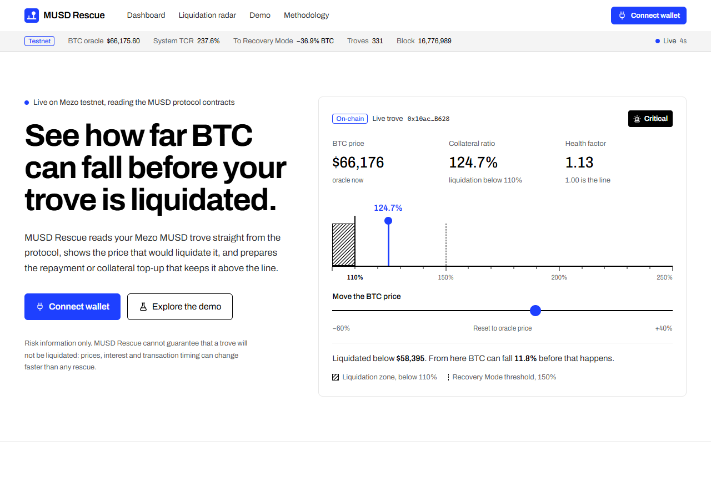
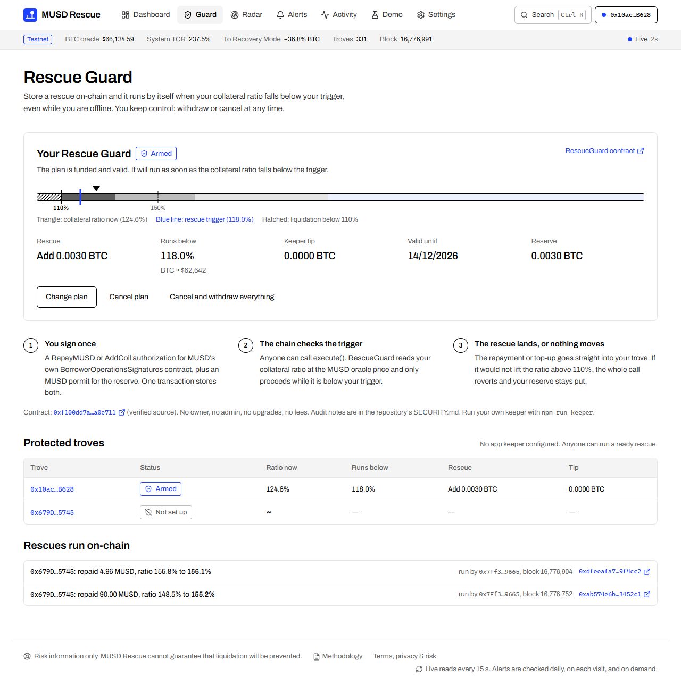
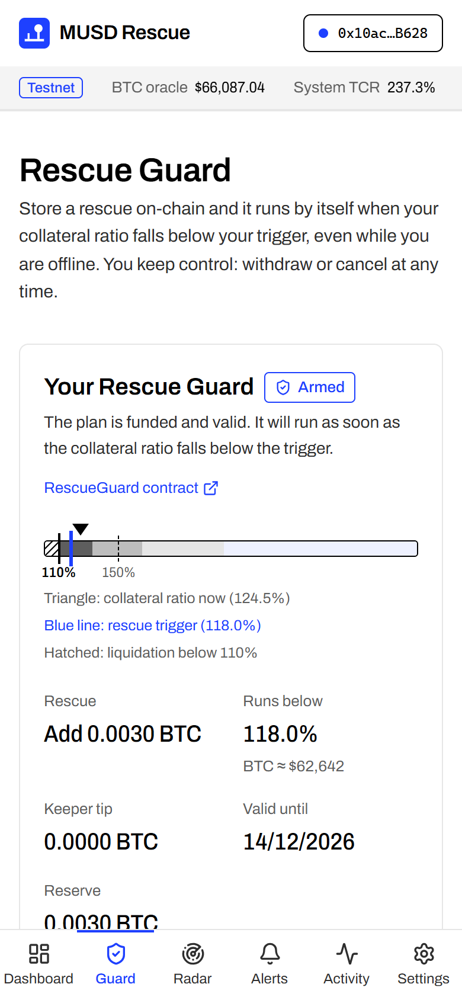
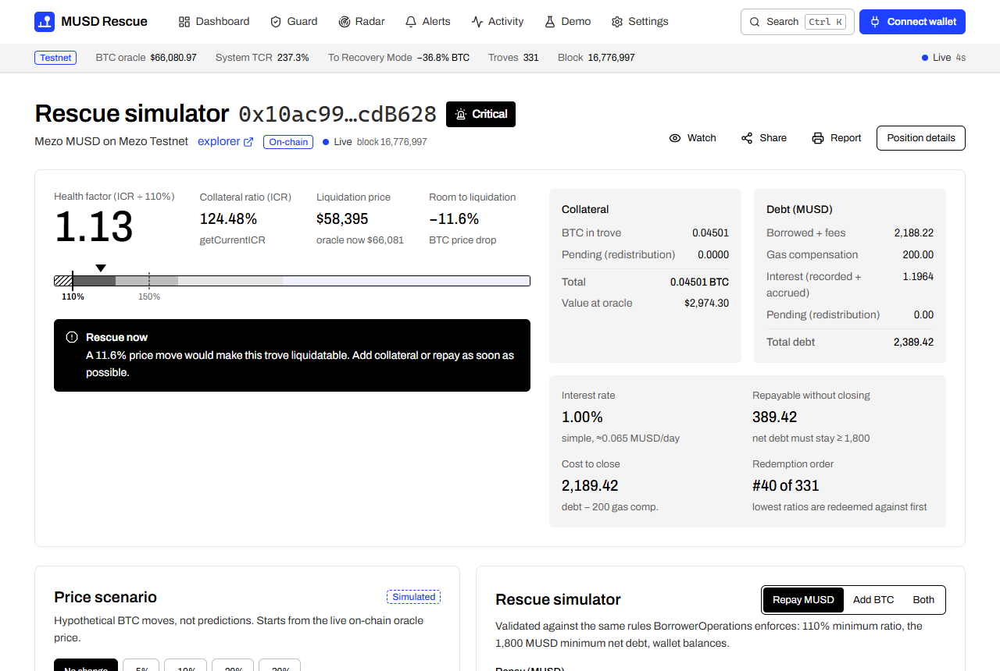
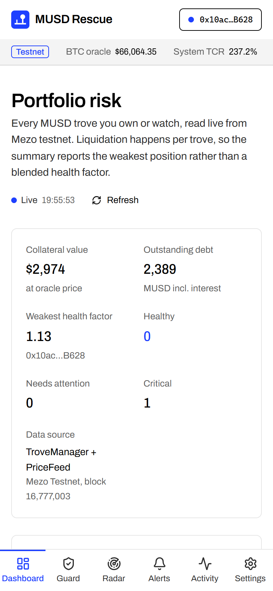
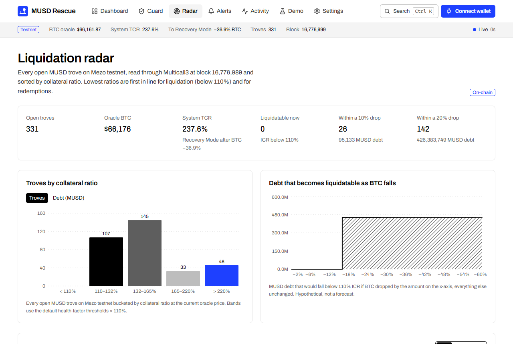
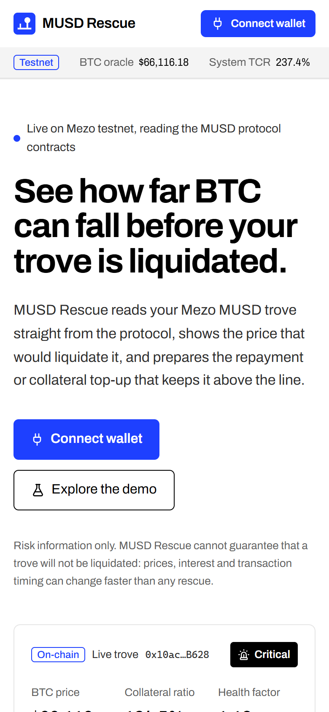
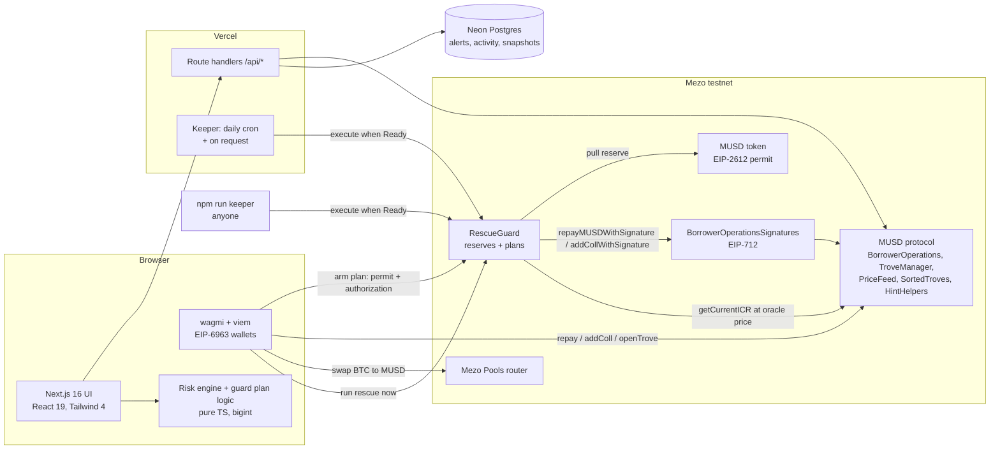

# MUSD Rescue

**See how far BTC can fall before your MUSD trove is liquidated, then make sure a rescue runs even when you are not watching.**

**Live app: https://musd-rescue.vercel.app** (Mezo testnet) · Contract: [`RescueGuard` 0xf100dd7a…e711](https://explorer.test.mezo.org/address/0xf100dd7ae2d9dc651e9c9545790aa9c7b5a0e711#code) (verified)

MUSD Rescue is a liquidation-prevention tool for borrowers of **MUSD, Mezo's Bitcoin-backed stablecoin**. It reads every MUSD trove straight from the protocol contracts, shows the price that would liquidate it, prepares the exact repayment or collateral top-up that the contract will accept, and, new in Wave 2, stores that rescue **on-chain** in RescueGuard. RescueGuard runs it the moment the collateral ratio falls below the borrower's trigger, and anyone can trigger it.

> Risk information only. MUSD Rescue cannot guarantee that liquidation will be prevented.



## Why it matters

An MUSD trove is liquidated the moment its collateral ratio drops below 110%, and the liquidator takes the whole trove. Borrowers have to answer, under time pressure: how far can BTC fall? How much MUSD do I repay, or BTC do I add? Will the contract even accept it (minimum net debt, Recovery Mode)? And what if this happens at 3 a.m.?

Wave 1 answered the first three. **Wave 2 answers the last one.** A borrower signs a rescue once. RescueGuard holds the reserve and checks the trigger on-chain, so the rescue lands without the borrower online, and only when it is actually needed.

## Try it in two minutes

1. Open **https://musd-rescue.vercel.app**. Drag the BTC price under the gauge: the live demo trove `0x10ac…B628` slides toward the hatched 110% liquidation zone.
2. Open **Guard** (`/guard?owner=0x10ac9924a78051BdD770978740C5084205cdB628`). That trove is protected by a real plan: add 0.003 BTC if its ratio falls below 118%. The registry below lists the rescues already run on-chain and which wallet ran them.
3. Open **Radar** to see all ~330 open troves and how much debt becomes liquidatable for a given BTC drop.
4. With your own wallet: get testnet BTC from the [Mezo faucet](https://faucet.test.mezo.org/), connect, and on the dashboard press **Open a trove**. Then on **Guard**, store a plan (two free signatures, one transaction). Set the trigger above your current ratio and the plan is immediately **Ready to run**. Run it yourself or from a second wallet, and watch the debt fall.
5. No wallet? **Demo** has three example troves with the same simulator.

## What's new in Wave 2

| | |
|---|---|
| **RescueGuard (on-chain auto-rescue)** | A new, audited contract. The borrower deposits an MUSD reserve (EIP-2612 permit, no approve) or BTC, and stores a `RepayMUSD`/`AddColl` authorization signed for Mezo's own `BorrowerOperationsSignatures`. Anyone may call `execute()`. It only proceeds while the trove's ICR at the MUSD oracle price is below the trigger, and it reverts unless the rescue lifts the trove above 110%. Keepers can earn an owner-set tip. No owner, no admin, no upgrades, no fees. |
| **Guard page** | Set up, change, cancel and withdraw. Plans are sized from the trigger price. Every contract and protocol rule is explained before the wallet opens. Status runs Armed, Ready to run, Needs a new signature, and so on. Anyone can press "Run rescue now". A public registry lists protected troves and rescues run on-chain. |
| **Keeper** | A daily Vercel cron plus an "Ask the app keeper" button (when a keeper key is configured), and a standalone `npm run keeper` that anyone can run. |
| **Get MUSD with BTC** | In-app BTC to MUSD swap through **Mezo Pools**, from the account menu, the simulator (when the wallet is short) and Guard setup. |
| **Open a trove in the app** | Faucet BTC to an open trove without leaving the app: live preview of debt, ratio, liquidation price and risk. |
| **Audit** | An independent review found 3 issues (1 Medium, 2 Low). Each got a failing proof-of-concept test, a fix and a regression test. See [docs/SECURITY.md](docs/SECURITY.md). |
| **Redesign** | Blue, black and white only. Risk is shown by ink density (healthy = blue, critical = solid black), and the liquidation zone is always black hatching. No gradients or glows. Works from 360 px phones to desktop. |

## How it uses Mezo

- **MUSD protocol, read directly.** `TroveManager`, `BorrowerOperations`, `PriceFeed`, `SortedTroves`, `HintHelpers`, `InterestRateManager` and `StabilityPool`, through Multicall3 at a single block. Archive `eth_call` is used for history.
- **`BorrowerOperationsSignatures` (EIP-712).** RescueGuard executes rescues through MUSD's own signature entry point. On a signed repayment the MUSD is burned from the caller (RescueGuard's reserve), and that is what makes a reserve-backed rescue possible without custody of the trove.
- **MUSD EIP-2612 `permit`.** Reserve deposits take one transaction with no separate approve (domain "Mezo USD").
- **Mezo Pools.** `swapExactTokensForTokens` on the router through the volatile BTC/MUSD pool. BTC is the ERC-20 precompile at `0x7b7C…0000`.
- **Protocol rules mirrored exactly.** 110% MCR, Recovery Mode at 150% TCR (MUSD does not liquidate between 110% and 150%), 1,800 MUSD minimum net debt, 200 MUSD gas compensation, interest-first repayment, NICR-based list hints, and the 60-second oracle staleness rule.
- **Mezo specifics handled.** Explicit gas floors (the RPC returns low estimates), `eth_getLogs` in 10k-block chunks, `evmVersion: london` with OZ 5.0.2, and the 10M block gas limit.

## Features

- **Rescue Guard** (`/guard`): on-chain plans, status, run now, registry, retire-and-replace flow.
- **Dashboard** (`/dashboard`): your trove plus watched troves, weakest health factor, risk counts, open a trove.
- **Position detail** (`/positions/[address]`): debt breakdown (principal, gas compensation, interest, pending redistribution), on-chain health history, event log, alert rules, printable report.
- **Rescue simulator** (`/rescue/[address]`): price scenarios, repay / add collateral / both, target solver, option comparison, and the live transaction flow (server prepares from fresh state → you confirm → wallet signs → receipt verified → trove re-read).
- **Liquidation radar** (`/radar`): every open trove at one block, a ratio histogram, and liquidatable debt against BTC drop.
- **Alerts** (`/alerts`): warning and critical zone, health-factor drop, price drop, unexpected debt, stale data, Recovery Mode. Quiet hours, daily cron, Check now, browser notifications.
- **Activity** (`/activity`), **Settings** (`/settings`), **Demo** (`/demo`), **Methodology** (`/methodology`), Sign-In with Ethereum, ⌘K command palette.

<table>
  <tr>
    <td width="66%"></td>
    <td></td>
  </tr>
  <tr>
    <td></td>
    <td></td>
  </tr>
  <tr>
    <td></td>
    <td></td>
  </tr>
</table>

## Architecture



**A guarded rescue, step by step.** (1) The UI sizes a plan from the trigger price with the same engine as the simulator. (2) The wallet signs a `RepayMUSD` authorization for BOS at the borrower's current nonce, plus an MUSD permit. (3) One transaction, `armRepayWithPermit`, deposits the reserve and stores the plan, after RescueGuard verifies the signature on-chain. (4) When BTC falls, a keeper or anyone calls `execute`. RescueGuard re-reads the ICR at the oracle price, calls BOS, checks that exactly the authorized MUSD was burned and that the trove is now above 110%, and only then pays the tip.

## Contracts (Mezo testnet, chain 31611)

| Contract | Address |
|---|---|
| **RescueGuard** (this project) | [`0xf100dd7ae2d9dc651e9c9545790aa9c7b5a0e711`](https://explorer.test.mezo.org/address/0xf100dd7ae2d9dc651e9c9545790aa9c7b5a0e711#code) (verified, block 16,776,263) |
| BorrowerOperationsSignatures | [`0xD757e3646AF370b15f32EB557F0F8380Df7D639e`](https://explorer.test.mezo.org/address/0xD757e3646AF370b15f32EB557F0F8380Df7D639e) |
| BorrowerOperations | [`0xCdF7028ceAB81fA0C6971208e83fa7872994beE5`](https://explorer.test.mezo.org/address/0xCdF7028ceAB81fA0C6971208e83fa7872994beE5) |
| TroveManager | [`0xE47c80e8c23f6B4A1aE41c34837a0599D5D16bb0`](https://explorer.test.mezo.org/address/0xE47c80e8c23f6B4A1aE41c34837a0599D5D16bb0) |
| PriceFeed | [`0x86bCF0841622a5dAC14A313a15f96A95421b9366`](https://explorer.test.mezo.org/address/0x86bCF0841622a5dAC14A313a15f96A95421b9366) |
| SortedTroves | [`0x722E4D24FD6Ff8b0AC679450F3D91294607268fA`](https://explorer.test.mezo.org/address/0x722E4D24FD6Ff8b0AC679450F3D91294607268fA) |
| HintHelpers | [`0x4e4cBA3779d56386ED43631b4dCD6d8EacEcBCF6`](https://explorer.test.mezo.org/address/0x4e4cBA3779d56386ED43631b4dCD6d8EacEcBCF6) |
| MUSD token | [`0x118917a40FAF1CD7a13dB0Ef56C86De7973Ac503`](https://explorer.test.mezo.org/token/0x118917a40FAF1CD7a13dB0Ef56C86De7973Ac503) |
| Mezo Pools router | [`0x9a1ff7FE3a0F69959A3fBa1F1e5ee18e1A9CD7E9`](https://explorer.test.mezo.org/address/0x9a1ff7FE3a0F69959A3fBa1F1e5ee18e1A9CD7E9) |
| Multicall3 | [`0xcA11bde05977b3631167028862bE2a173976CA11`](https://explorer.test.mezo.org/address/0xcA11bde05977b3631167028862bE2a173976CA11) |

Deployment record: [`deployments/mezo-testnet.json`](deployments/mezo-testnet.json). An earlier deployment from the previous key, `0x79876802…`, is kept there marked superseded.

## Real transactions (browser e2e, real wallets, Mezo testnet)

Driven through the live UI in Chrome by four wallets: the deployer `0x679D…5745`, the demo trove owner `0x10ac…B628`, a third-party watcher `0x7Ff3…9665`, and an outsider `0xDe9F…56ac`. Every hash below was confirmed through the explorer API. Full log: [`deployments/e2e-wave2.json`](deployments/e2e-wave2.json).

| Action | Tx |
|---|---|
| Open a trove in the app (0.047 BTC, 1,900 MUSD) | [`0x38a7a3ca…914f`](https://explorer.test.mezo.org/tx/0x38a7a3ca60059cb544f7a71d5b075fc00880656181cd6d71bdb18ef49115914f) |
| Store a 100 MUSD repay plan: authorization + permit in one tx | [`0x2d43c381…a4d3`](https://explorer.test.mezo.org/tx/0x2d43c381a44c76444bfa530ad0215eaa6935988fe14d11777d321f1fb4d8a4d3) |
| Change the plan (old authorization retired first, RG-02 fix) | [`0xb322d119…05f6`](https://explorer.test.mezo.org/tx/0xb322d1193f89006cb88f5fc78f5f4d7324a8f4fa7aafa2feee39d0e745fe05f6) |
| **Third party runs the rescue:** debt −90 MUSD, ratio 148.5% → 155.2%, tip 0.9 MUSD | [`0xab574e6b…52c1`](https://explorer.test.mezo.org/tx/0xab574e6bf2b782928e0d8b18eec224fef8982ac07cd6d17af4d807439a3452c1) |
| Swap BTC → MUSD through Mezo Pools | [`0x5b83926b…0aba`](https://explorer.test.mezo.org/tx/0x5b83926b5d7ae7c76611916ffb35de2725c435132f255a137ad683a9624d0aba) |
| Repay through the simulator (prepare → confirm → sign → verify) | [`0x9cf4f7be…b9a0`](https://explorer.test.mezo.org/tx/0x9cf4f7be6dda78a77cf1b6457439e0ee5fa864bb8aa86bf60b7d9a91a845b9a0) |
| Protect the demo trove: 0.003 BTC top-up below 118% | [`0x3a12bba7…f673`](https://explorer.test.mezo.org/tx/0x3a12bba70edcb3435556d64153685412e9daee62a8a9bcda886448b92d50f673) |
| Cancel and withdraw everything (`exit`) | [`0x4de8a35a…21d2d`](https://explorer.test.mezo.org/tx/0x4de8a35acd8bdb8cc67cc33520714fc27e60d39cca64adf7268777ea96221d2d) |
| Second guarded rescue run by a third party (second run) | [`0xdfeeafa7…4cc2`](https://explorer.test.mezo.org/tx/0xdfeeafa7af1ca13b560ff4f198a7b1cb1501f89576a831a65b8e5cd4ba9f4cc2) |
| RescueGuard deployment | [`0xa9224eb8…6072`](https://explorer.test.mezo.org/tx/0xa9224eb8d6af78f5e8d39ec20ab6004ddfc12f445509166dc52b643c4eb56072) |

Wave 1 transactions from the same app: `addColl` [`0x0bd5dc07…3b47`](https://explorer.test.mezo.org/tx/0x0bd5dc075099b8158caf7795cc140150ff14e7055485b1a0888d6f13db023b47) and `repayMUSD` [`0x175519a8…bb2f`](https://explorer.test.mezo.org/tx/0x175519a8212682dda3b66f345bb091d4baad092bfd48b1fe517e266830f3bb2f).

## Security

Full write-up: **[docs/SECURITY.md](docs/SECURITY.md)**.

- An independent review of every function and money path found **RG-01 (Medium)**: in Recovery Mode a rescue that left the trove under 110% was executed and paid. Also **RG-02 (Low)**: a replaced authorization could be replayed to disable the new plan. And **RG-03 (Low)**: an unexecutable repay plan showed as Ready. Each has a failing proof-of-concept committed before its fix (`20c0ab6` → `3fd8b91`) and is now a regression test.
- Funds leave RescueGuard only to their owner, into the owner's own trove as an authorized rescue, or as the owner-chosen tip (≤ 10%). There are no privileged roles.
- What a contract cannot prevent (keeper liveness, price gaps, oracle and protocol trust, EOA-only signatures) is spelled out in the same document.
- App: non-custodial, SIWE sessions in HttpOnly cookies, zod-validated inputs, receipts verified server-side, no keys in the repo or bundle. Scripts read testnet keys at runtime from gitignored files.

## Testing

| Suite | Result |
|---|---|
| App unit tests (Vitest): risk engine, simulator, transaction flow, alerts, data integrity, guard plan logic incl. an EIP-712 digest cross-check | **107 / 107** |
| Contract tests (Hardhat): RescueGuard unit tests, reentrancy, signature replay, invariants, 4 audit regressions | **48 / 48** |
| Fork test against the real MUSD protocol (forked Mezo testnet) | **1 / 1** |
| Browser e2e on Mezo testnet with real wallets and transactions (`scripts/e2e-browser.ts`) | **19 / 19** |
| `tsc --noEmit`, `eslint .`, `next build` | clean |

```bash
npm test                     # Vitest
npm run contracts:test       # Hardhat unit + audit regression tests
npm run contracts:test:fork  # RescueGuard against the forked real protocol
E2E_BASE_URL=http://localhost:3300 npx tsx scripts/e2e-browser.ts   # real testnet txs through the UI
npm run keeper               # run your own keeper
```

## Local setup

```bash
npm install
vercel link --yes --project musd-rescue   # or bring your own Neon database
vercel env pull .env.local --yes          # DATABASE_URL, SESSION_SECRET, CRON_SECRET
npm run db:migrate                        # idempotent, schema "rescue"
npm run dev                               # http://localhost:3000
```

Contracts: `cd contracts && npm install && npx hardhat test`. Deploy with `npm run guard:deploy`, which reads `PRIVATE_KEY` from the gitignored `.env.deployer`, writes `deployments/mezo-testnet.json` and regenerates `src/config/guard.ts`.

| Variable | Purpose |
|---|---|
| `DATABASE_URL` | Neon Postgres |
| `SESSION_SECRET` | HS256 key for the session cookie |
| `CRON_SECRET` | Bearer token for `/api/cron/monitor` |
| `KEEPER_PRIVATE_KEY` | optional: testnet key the server keeper uses to run Ready rescues (earns tips, never holds user funds) |
| `NEXT_PUBLIC_MEZO_TESTNET_RPC`, `NEXT_PUBLIC_SITE_URL` | optional overrides |

## Known limitations

- Rescues are permissionless, not instant: someone has to call `execute`. On Vercel Hobby the cron runs daily. For continuous coverage, run `npm run keeper` (anyone can) or press "Run rescue now".
- A plan is one rescue. After it runs, the borrower arms a new one.
- BOS signatures are ECDSA, so smart-contract wallets cannot sign plans.
- Alerts are in-app and in the browser. No email or push delivery.
- Mainnet addresses are listed read-only. No mainnet transactions.

## Roadmap

Multi-step plans (several pre-signed rescues at successive nonces), a keeper network with tip markets, Stability-Pool-aware liquidation previews, push and email alerts, a mainnet launch of RescueGuard after an external audit, and more Mezo lending adapters through the existing `LendingAdapter` interface.

---

Built for the Mezo ecosystem. Testnet software. Not financial advice.
