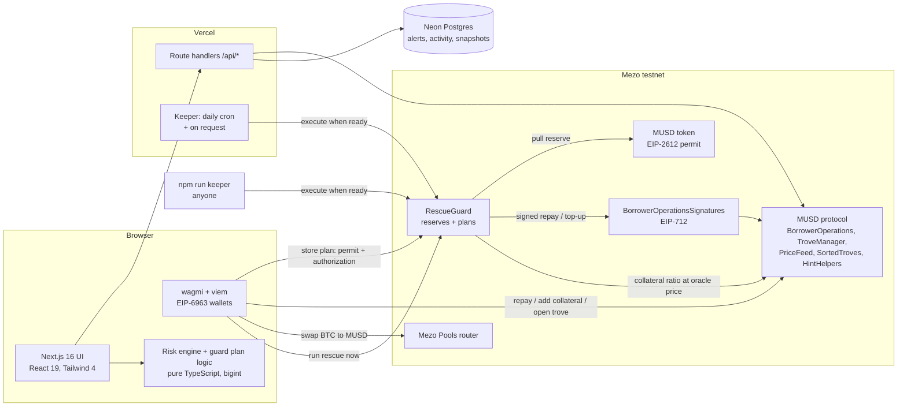

# MUSD Rescue

**Liquidation protection for Mezo MUSD borrowers. See how far BTC can fall before your trove is liquidated, plan a rescue the contract will accept, and store it on-chain so it runs even when you are offline.**

| | |
|---|---|
| Live app | https://musd-rescue.vercel.app (Mezo testnet) |
| Network | Mezo testnet, chain 31611 |
| Our contract | RescueGuard [`0xf100dd7ae2d9dc651e9c9545790aa9c7b5a0e711`](https://explorer.test.mezo.org/address/0xf100dd7ae2d9dc651e9c9545790aa9c7b5a0e711#code) (source verified) |
| Security | [docs/SECURITY.md](docs/SECURITY.md) |
| Submission answers | [docs/SUBMISSION.md](docs/SUBMISSION.md) |

> Risk information only. MUSD Rescue cannot guarantee that liquidation will be prevented.

---

## What is MUSD Rescue?

MUSD is Mezo's Bitcoin-backed stablecoin. You lock BTC in a **trove** and borrow MUSD against it. If the trove's collateral ratio falls below **110%**, anyone can liquidate it and take the whole trove. BTC can drop fast, so borrowers need to know how close they are to that line and be able to act in time, even when they are asleep or away.

MUSD Rescue is a web app plus one smart contract that does three things:

1. **Shows your real risk.** It reads your trove straight from the MUSD contracts on Mezo: collateral ratio, health factor, liquidation price, and how far BTC can fall before you are liquidated.
2. **Plans a rescue that will actually go through.** It simulates repaying MUSD or adding BTC against the protocol's own rules (minimum debt, Recovery Mode, the 110% line) and prepares the exact transaction the contract accepts.
3. **Rescues you while you are offline.** With **Rescue Guard** you sign a rescue once and our contract holds the reserve. The moment your collateral ratio drops below your trigger, anyone can run the rescue, and the contract checks the trigger on-chain before any funds move.

## Who it is for

- **MUSD borrowers** who want to know their liquidation price and keep their trove safe.
- **New Mezo users**, who can go from faucet BTC to an open, protected trove without leaving the app.
- **Keepers**, who can earn the tips borrowers set by running ready rescues (`npm run keeper`).
- **Anyone curious about MUSD risk**: the liquidation radar shows every open trove and how much debt becomes liquidatable for a given BTC drop. No wallet is needed.

## What it does

| Feature | What you get |
|---|---|
| **Rescue Guard** | Store a repayment (MUSD reserve) or collateral top-up (BTC reserve) on-chain. It runs when your ratio falls below your trigger. Change, cancel or withdraw any time. Anyone can press "Run rescue now" once a plan is ready. |
| **Risk dashboard** | Your trove and any troves you watch: collateral value, debt, weakest health factor, risk level, and data freshness. |
| **Position detail** | Full debt breakdown (principal, 200 MUSD gas deposit, interest, pending redistribution), health history read from past blocks, event log, alert rules, printable report. |
| **Rescue simulator** | Drag the BTC price, try repaying, adding BTC or both, solve for a target health factor, and compare options. Then sign the real transaction: the server prepares it from fresh data, you confirm, your wallet signs, and the receipt is verified on-chain. |
| **Get MUSD with BTC** | Swap BTC for MUSD through Mezo Pools inside the app, when you need MUSD to repay or to fund a guard. |
| **Open a trove** | Lock testnet BTC and borrow MUSD from the app, with a live preview of debt, ratio, liquidation price and risk. |
| **Liquidation radar** | All ~330 open troves at one block: ratio histogram and liquidatable debt against BTC drop. |
| **Alerts** | Warning and critical zones, health-factor drop, price drop, unexpected debt, stale data, Recovery Mode. Quiet hours, daily checks, on-demand checks and browser notifications. |
| **Demo** | Three example troves for trying everything without a wallet. |

## Try it in two minutes

1. Open **https://musd-rescue.vercel.app** and drag the BTC price slider. The live demo trove `0x10ac…B628` moves toward the hatched 110% liquidation zone.
2. Open **Guard** (`/guard?owner=0x10ac9924a78051BdD770978740C5084205cdB628`). That trove is protected by a real plan: add 0.003 BTC if its ratio falls below 118%. The page also lists the rescues already run on-chain and which wallet ran them.
3. Open **Radar** to see every open trove and the debt at risk for each BTC drop.
4. With your own wallet: get testnet BTC from the [Mezo faucet](https://faucet.test.mezo.org/), connect, and press **Open a trove** on the dashboard. Then on **Guard**, store a plan (two free signatures and one transaction). Set the trigger above your current ratio and the plan is ready at once. Run it from any wallet and watch your debt fall.
5. No wallet? Open **Demo**.

## How Rescue Guard works

1. **You sign once.** The app sizes a rescue from your trigger price. Your wallet signs a `RepayMUSD` (or `AddColl`) authorization for Mezo's own `BorrowerOperationsSignatures` contract, plus an MUSD permit for the reserve. Both are free signatures.
2. **One transaction stores it.** `armRepayWithPermit` deposits the reserve and stores the plan. RescueGuard verifies your signature on-chain first.
3. **The chain checks the trigger.** Anyone (the app's keeper, someone running `npm run keeper`, or any visitor) can call `execute()`. RescueGuard reads your collateral ratio at the MUSD oracle price and only continues while it is below your trigger.
4. **The rescue lands, or nothing moves.** The repayment or top-up goes straight into your trove through Mezo's contracts. RescueGuard then checks that exactly the authorized amount was used and that the trove is back above 110%. Only then is the keeper's tip paid. If any check fails, the whole call reverts and your reserve stays put.

Your funds can only ever go back to you, into your own trove as the rescue you signed, or as the tip you chose (at most 10%). The contract has no owner, no admin, no upgrades and no fees.

## How it uses Mezo

- **MUSD protocol, read directly.** TroveManager, BorrowerOperations, PriceFeed, SortedTroves, HintHelpers, InterestRateManager and StabilityPool, through Multicall3 at a single block, with archive `eth_call` for history.
- **`BorrowerOperationsSignatures` (EIP-712).** Rescues run through MUSD's own signature entry point. On a signed repayment the MUSD is burned from the caller (RescueGuard's reserve), which makes reserve-backed rescues possible without RescueGuard ever controlling the trove.
- **MUSD EIP-2612 permit.** Funding a reserve is a single transaction with no separate approve.
- **Mezo Pools.** BTC to MUSD swaps through the router and the BTC/MUSD pool. BTC is the ERC-20 precompile at `0x7b7C…0000`.
- **The protocol's rules, mirrored exactly.** 110% minimum ratio, Recovery Mode below 150% system ratio (MUSD still liquidates only below 110%), 1,800 MUSD minimum net debt, 200 MUSD gas compensation, interest-first repayment, list hints, and the 60-second oracle freshness rule.
- **Mezo specifics handled.** Explicit gas limits (the RPC can return low estimates), event logs read in 10,000-block chunks, contracts compiled for the `london` EVM with OpenZeppelin 5.0.2.

## What's new in Wave 2

- **RescueGuard contract and Guard page**: on-chain, trigger-gated rescues anyone can run.
- **Keepers**: a daily server job, an "Ask the app keeper" button, and an open-source `npm run keeper`.
- **Mezo Pools swap** and **in-app trove opening** for faster onboarding.
- **Security audit**: 3 findings (1 Medium, 2 Low). Each was proven with a failing test, fixed, and kept as a regression test.
- **Fork test** of RescueGuard against the real MUSD contracts, and a **browser end-to-end test** on testnet with four real wallets (19/19 checks).
- **Redesign** in blue, black and white only. Risk is shown by ink density (healthy is blue, critical is solid black) and the liquidation zone is always black hatching. It works from 360 px phones to desktop.

## Architecture



**State that matters lives on-chain.** Troves, plans, reserves and rescues are all on Mezo. The Postgres database only stores app conveniences: alert rules, notifications, the activity log and price snapshots for charts.

## Contracts (Mezo testnet)

| Contract | Address |
|---|---|
| **RescueGuard** (this project) | [`0xf100dd7ae2d9dc651e9c9545790aa9c7b5a0e711`](https://explorer.test.mezo.org/address/0xf100dd7ae2d9dc651e9c9545790aa9c7b5a0e711#code) (verified, block 16,776,263) |
| BorrowerOperationsSignatures | [`0xD757e3646AF370b15f32EB557F0F8380Df7D639e`](https://explorer.test.mezo.org/address/0xD757e3646AF370b15f32EB557F0F8380Df7D639e) |
| BorrowerOperations | [`0xCdF7028ceAB81fA0C6971208e83fa7872994beE5`](https://explorer.test.mezo.org/address/0xCdF7028ceAB81fA0C6971208e83fa7872994beE5) |
| TroveManager | [`0xE47c80e8c23f6B4A1aE41c34837a0599D5D16bb0`](https://explorer.test.mezo.org/address/0xE47c80e8c23f6B4A1aE41c34837a0599D5D16bb0) |
| PriceFeed | [`0x86bCF0841622a5dAC14A313a15f96A95421b9366`](https://explorer.test.mezo.org/address/0x86bCF0841622a5dAC14A313a15f96A95421b9366) |
| SortedTroves | [`0x722E4D24FD6Ff8b0AC679450F3D91294607268fA`](https://explorer.test.mezo.org/address/0x722E4D24FD6Ff8b0AC679450F3D91294607268fA) |
| HintHelpers | [`0x4e4cBA3779d56386ED43631b4dCD6d8EacEcBCF6`](https://explorer.test.mezo.org/address/0x4e4cBA3779d56386ED43631b4dCD6d8EacEcBCF6) |
| MUSD token | [`0x118917a40FAF1CD7a13dB0Ef56C86De7973Ac503`](https://explorer.test.mezo.org/token/0x118917a40FAF1CD7a13dB0Ef56C86De7973Ac503) |
| Mezo Pools router | [`0x9a1ff7FE3a0F69959A3fBa1F1e5ee18e1A9CD7E9`](https://explorer.test.mezo.org/address/0x9a1ff7FE3a0F69959A3fBa1F1e5ee18e1A9CD7E9) |
| Multicall3 | [`0xcA11bde05977b3631167028862bE2a173976CA11`](https://explorer.test.mezo.org/address/0xcA11bde05977b3631167028862bE2a173976CA11) |

Deployment record: [`deployments/mezo-testnet.json`](deployments/mezo-testnet.json). An earlier deployment from the previous key is kept there, marked superseded.

## Real transactions on Mezo testnet

These were made through the live UI in Chrome by four wallets: the deployer `0x679D…5745`, the demo trove owner `0x10ac…B628`, a third-party watcher `0x7Ff3…9665` and an outsider `0xDe9F…56ac`. Every hash was confirmed through the explorer API. Full log: [`deployments/e2e-wave2.json`](deployments/e2e-wave2.json).

| Action | Transaction |
|---|---|
| RescueGuard deployed | [`0xa9224eb8…6072`](https://explorer.test.mezo.org/tx/0xa9224eb8d6af78f5e8d39ec20ab6004ddfc12f445509166dc52b643c4eb56072) |
| Trove opened in the app (0.047 BTC, 1,900 MUSD) | [`0x38a7a3ca…914f`](https://explorer.test.mezo.org/tx/0x38a7a3ca60059cb544f7a71d5b075fc00880656181cd6d71bdb18ef49115914f) |
| 100 MUSD repay plan stored (authorization + permit, one transaction) | [`0x2d43c381…a4d3`](https://explorer.test.mezo.org/tx/0x2d43c381a44c76444bfa530ad0215eaa6935988fe14d11777d321f1fb4d8a4d3) |
| Plan changed (old authorization retired first) | [`0xb322d119…05f6`](https://explorer.test.mezo.org/tx/0xb322d1193f89006cb88f5fc78f5f4d7324a8f4fa7aafa2feee39d0e745fe05f6) |
| **Rescue run by a third party**: debt −90 MUSD, ratio 148.5% → 155.2%, tip 0.9 MUSD | [`0xab574e6b…52c1`](https://explorer.test.mezo.org/tx/0xab574e6bf2b782928e0d8b18eec224fef8982ac07cd6d17af4d807439a3452c1) |
| BTC → MUSD swap through Mezo Pools | [`0x5b83926b…0aba`](https://explorer.test.mezo.org/tx/0x5b83926b5d7ae7c76611916ffb35de2725c435132f255a137ad683a9624d0aba) |
| Repayment through the simulator (prepare, confirm, sign, verify) | [`0x9cf4f7be…b9a0`](https://explorer.test.mezo.org/tx/0x9cf4f7be6dda78a77cf1b6457439e0ee5fa864bb8aa86bf60b7d9a91a845b9a0) |
| Demo trove protected: 0.003 BTC top-up below 118% | [`0x3a12bba7…f673`](https://explorer.test.mezo.org/tx/0x3a12bba70edcb3435556d64153685412e9daee62a8a9bcda886448b92d50f673) |
| Plan cancelled and reserve withdrawn (`exit`) | [`0x4de8a35a…1d2d`](https://explorer.test.mezo.org/tx/0x4de8a35acd8bdb8cc67cc33520714fc27e60d39cca64adf7268777ea96221d2d) |
| Second rescue run by a third party | [`0xdfeeafa7…4cc2`](https://explorer.test.mezo.org/tx/0xdfeeafa7af1ca13b560ff4f198a7b1cb1501f89576a831a65b8e5cd4ba9f4cc2) |

Wave 1 transactions from the same app: `addColl` [`0x0bd5dc07…3b47`](https://explorer.test.mezo.org/tx/0x0bd5dc075099b8158caf7795cc140150ff14e7055485b1a0888d6f13db023b47) and `repayMUSD` [`0x175519a8…bb2f`](https://explorer.test.mezo.org/tx/0x175519a8212682dda3b66f345bb091d4baad092bfd48b1fe517e266830f3bb2f).

## Security

The full write-up is in **[docs/SECURITY.md](docs/SECURITY.md)**.

- **Audit.** An independent review covered every function and money path and found three issues:
  - **RG-01 (Medium):** in Recovery Mode, a rescue that left the trove under 110% was still executed and paid.
  - **RG-02 (Low):** an authorization that had been replaced could be replayed to disable the new plan.
  - **RG-03 (Low):** a repay plan that could never execute showed as ready.

  Each has a failing proof-of-concept committed before its fix and is now a regression test.
- **No privileged roles.** Funds leave RescueGuard only to their owner, into the owner's own trove, or as the owner-chosen tip (at most 10%).
- **What no contract can prevent** is spelled out too: keeper liveness, sudden price gaps, oracle and protocol trust, and EOA-only signatures.
- **The app** is non-custodial, with Sign-In with Ethereum sessions in HttpOnly cookies, validated inputs and receipts verified server-side. There are no keys in the repository or the browser bundle. Scripts read testnet keys at runtime from gitignored files.

## Testing

| Suite | Result |
|---|---|
| App unit tests (Vitest): risk engine, simulator, transaction flow, alerts, data integrity, guard plan logic incl. an EIP-712 digest cross-check | **107 / 107** |
| Contract tests (Hardhat): RescueGuard behaviour, reentrancy, signature replay, invariants, 4 audit regressions | **48 / 48** |
| Fork test against the real MUSD contracts (forked Mezo testnet) | **1 / 1** |
| Browser end-to-end on Mezo testnet with real wallets and transactions | **19 / 19** |
| TypeScript, ESLint, production build | clean |

```bash
npm test                     # app unit tests
npm run contracts:test       # contract tests + audit regressions
npm run contracts:test:fork  # RescueGuard against the real (forked) MUSD protocol
E2E_BASE_URL=http://localhost:3300 npx tsx scripts/e2e-browser.ts   # real testnet transactions through the UI
npm run keeper               # run your own keeper
```

## Tech stack

Next.js 16 (App Router, Turbopack), React 19, TypeScript (strict), Tailwind CSS 4, Radix primitives, Recharts, wagmi 2 and viem 2, TanStack Query, Neon Postgres, Vercel (functions, cron, analytics). Contracts: Solidity 0.8.24, OpenZeppelin 5.0.2, Hardhat. Tests: Vitest, Hardhat/Chai, Playwright.

## Project structure

```
contracts/            RescueGuard.sol, mocks, unit/audit/fork tests (Hardhat)
src/app/              pages (landing, dashboard, guard, positions, rescue, radar, alerts, ...) and /api routes
src/components/       UI: design system, guard, simulator, rescue flow, swap, open-trove
src/lib/risk/         risk engine: ratios, health factor, liquidation price, simulation, solvers
src/lib/guard/        guard plan sizing, checks, EIP-712 payloads, plain-English errors
src/lib/server/       MUSD adapter, guard registry and keeper, alerts monitor, auth, database
src/config/           chains, contract addresses and ABIs (guard.ts is generated on deploy)
scripts/              deploy, fund wallets, keeper, browser e2e, screenshots, chain probe
deployments/          contract addresses, test wallets (addresses only), e2e transaction log
docs/                 SECURITY.md, SUBMISSION.md, screenshots
```

## Run it locally

```bash
npm install
vercel link --yes --project musd-rescue   # or bring your own Neon database
vercel env pull .env.local --yes          # DATABASE_URL, SESSION_SECRET, CRON_SECRET
npm run db:migrate                        # creates the "rescue" schema (safe to re-run)
npm run dev                               # http://localhost:3000
```

Contracts: `cd contracts && npm install && npx hardhat test`. To deploy, run `npm run guard:deploy`. It reads `PRIVATE_KEY` from the gitignored `.env.deployer`, writes `deployments/mezo-testnet.json` and regenerates `src/config/guard.ts`.

| Variable | Purpose |
|---|---|
| `DATABASE_URL` | Neon Postgres connection |
| `SESSION_SECRET` | Signs the session cookie |
| `CRON_SECRET` | Protects the daily `/api/cron/monitor` job |
| `KEEPER_PRIVATE_KEY` | Optional. Testnet key the server keeper uses to run ready rescues. It pays gas and earns tips, and never holds user funds. |
| `NEXT_PUBLIC_MEZO_TESTNET_RPC`, `NEXT_PUBLIC_SITE_URL` | Optional overrides |

## FAQ

**Does MUSD Rescue hold my funds?** Only the reserve you deposit into RescueGuard, and only you can withdraw it. A rescue can only send it into your own trove as the amount you signed. Simulations and direct rescues never touch your funds until you sign in your wallet.

**What if nobody runs my rescue?** RescueGuard makes rescues permissionless, not instant. The app's keeper checks daily and on request, anyone can run `npm run keeper`, and any visitor can press "Run rescue now". A crash faster than the next check can still liquidate a trove.

**Why did the app ask me to retire an old authorization?** A signed authorization stays valid at Mezo's contract until it is used or expires. Before storing a different plan, the app moves your signature nonce on with a 1-wei collateral top-up, so the old signature can never be used to disable the new plan. This was audit finding RG-02.

**Can I use a smart-contract wallet?** Not for Rescue Guard. Mezo's signature contract verifies standard EOA signatures only.

**Is this on mainnet?** No. It is testnet software. Mainnet contract addresses are listed read-only in Settings.

## Known limitations

- Rescues need someone to call `execute`. On Vercel's Hobby plan the server job runs daily. For continuous coverage, run `npm run keeper`.
- A plan is one rescue. After it runs, you arm a new one.
- Alerts are in-app and browser notifications only, with no email or push delivery.
- Mainnet is read-only.

## Roadmap

- Multi-step plans: several pre-signed rescues in a row.
- A keeper network with tip markets.
- Push and email alerts.
- Stability-Pool-aware liquidation previews.
- RescueGuard on mainnet after an external audit.
- More Mezo lending protocols through the existing adapter interface.

---

Built for the Mezo ecosystem. Testnet software. Not financial advice.
